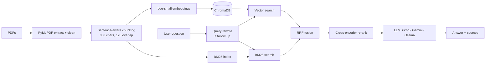

# 📄 DocuMind: RAG assistant with citations and measured retrieval quality

Ask questions about a collection of PDFs and get answers **grounded in the documents**, with the source file and page number for every claim. If the answer isn't in the documents, DocuMind says so instead of making something up.

**Live demo:** _add your Hugging Face Spaces link here_
**Domain:** _e.g. Indian government scheme guidelines (N PDFs, M pages)_

## Why this project is different from a "PDF chatbot"

- **Hybrid retrieval:** vector search (semantic) + BM25 (exact keywords), merged with Reciprocal Rank Fusion.
- **Cross-encoder reranking** of the top candidates before they reach the LLM.
- **Grounded answers with citations** `[1] [2]` mapped to file + page.
- **Follow-up questions** work via LLM query rewriting ("and what is its deadline?").
- **Evaluated, not just demoed:** a reviewed test set, Hit@k / MRR for every retrieval variant, and an LLM-judged faithfulness check.
- **Deployed:** FastAPI backend + Streamlit UI, containerised with Docker.

## Architecture



## Results

Fill this table with **your own numbers** by running `python -m eval.evaluate --chunk-sizes 500 800 1200` (it also writes `eval/results.md`).

| Chunk size | Retrieval method | Hit@5 | MRR |
|---|---|---|---|
| 800 | Vector only | – | – |
| 800 | Hybrid (BM25 + vector) | – | – |
| 800 | Hybrid + reranker | – | – |

Answer quality (LLM-as-judge, N questions): faithfulness – %, correctness – %.

## Quick start

```bash
git clone <your-repo-url> && cd documind
python -m venv .venv && source .venv/bin/activate      # Windows: .venv\Scripts\activate
pip install -r requirements.txt

cp .env.example .env          # then add ONE API key (Groq or Gemini), or use Ollama
# put your PDFs in data/pdfs/

python -m app.ingest                          # build the index
uvicorn app.main:app --reload                 # terminal 1: API  (http://localhost:8000/docs)
streamlit run ui/streamlit_app.py             # terminal 2: UI   (http://localhost:8501)
```

### Evaluate

```bash
python -m eval.make_testset --n 50            # drafts questions from your PDFs
# >>> open eval/testset.jsonl and fix / delete bad questions <<<
python -m eval.evaluate --chunk-sizes 500 800 1200 --judge --judge-n 20
```

### Tests

```bash
pytest -q
```

### Docker

```bash
docker build -t documind .
docker run -p 7860:7860 --env-file .env documind      # UI at http://localhost:7860
```

## Project structure

```
app/
  config.py      settings (env-overridable)
  utils.py       chunking, RRF, tokenizer (unit-tested)
  ingest.py      PDF -> chunks -> embeddings -> ChromaDB
  retriever.py   vector + BM25 + RRF + reranker
  llm.py         Groq / Gemini / Ollama client with retry
  rag.py         query rewrite, prompt, grounded generation
  main.py        FastAPI (/ask, /health)
ui/streamlit_app.py   chat interface with source expanders
eval/                 testset generator + evaluation script
tests/                unit tests
```

## Design decisions

- **Chunk size 800 chars / 120 overlap:** small enough for precise retrieval, large enough to keep a full thought; overlap protects answers that straddle a boundary. Compared against 500 and 1200 in the evaluation.
- **bge-small embeddings:** strong quality for its size, runs on CPU, free.
- **RRF instead of score mixing:** BM25 and cosine scores live on different scales; RRF only uses ranks, so there is nothing to tune.
- **Rerank 20 → keep 5:** a cross-encoder reads query and chunk together (more accurate, but slower), so it is applied only to a shortlist.
- **Temperature 0 + "answer only from context" prompt:** reduces hallucination; the fixed refusal sentence makes "not found" easy to detect.
- **Page-level evaluation:** a hit means the right *page* was retrieved, which keeps results comparable across chunk sizes.

## Limitations and future work

- Scanned PDFs need OCR (not included). Tables are flattened to plain text.
- The test set is LLM-drafted then hand-reviewed; the judge shares a model family with the generator, so answer-quality numbers are indicative.
- Ideas: streaming responses, metadata filters (by document), RAGAS metrics, caching, multi-lingual (Hindi) embeddings.
